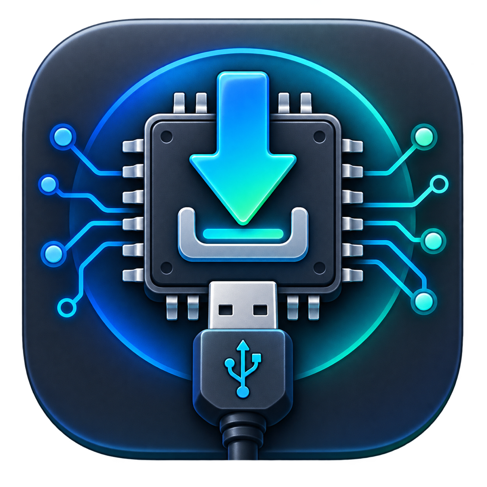

# RKFlash · RK 固件烧录



Rockchip 系列单板的 USB 固件烧录工具，提供 Ubuntu、macOS 与 Windows 三个原生版本，共用同一名称、图标和版本号。
原名 rktools / RKFlashMac；Linux 新包会自动替换已安装的 rktools。

| | Linux | Windows | macOS |
|---|---|---|---|
| 支持系统 | Ubuntu 22.04 / 24.04 / 26.04，amd64 | Windows 10/11，x64 | macOS 13+，Apple Silicon 与 Intel |
| 界面 | Rust + egui（[`crates/`](crates/)） | 与 Linux 共用同一份 Rust 代码 | Swift + SwiftUI（[`macos/`](macos/)） |
| 烧录核心 | Rockchip `upgrade_tool`（闭源） | `rkdeveloptool` + `libusb`（开源，[`native/`](native/)） | 与 Windows 共用 [`native/`](native/) |
| USB 驱动 | udev 规则 | WinUSB（libwdi 一键安装） | 无需驱动 |
| 安装包 | `.deb`（命令 `rkflash`） | 安装程序 `.exe` / 免安装 `.zip` | `.dmg`（`RKFlash.app`） |

Linux 与 Windows 共用 Rust 界面和后端分层，只是烧录工具适配器不同；macOS 与 Windows 共用
`native/` 下的 rkdeveloptool/libusb 源码。各目录下的 README 是完整的使用与构建说明。

## 下载

从 [Releases](https://github.com/open-center/rkflash/releases) 下载对应平台的安装包。所有产物统一命名为
`rkflash-<版本>-<平台>-<架构>.<扩展名>`，两个平台共用同一个版本号：

| 文件 | 说明 |
|---|---|
| `rkflash-<版本>-linux-amd64.deb` | Ubuntu 22.04 / 24.04 / 26.04 安装包 |
| `rkflash-<版本>-macos-arm64.dmg` | Apple Silicon Mac |
| `rkflash-<版本>-macos-x86_64.dmg` | Intel Mac |
| `rkflash-<版本>-windows-x64-setup.exe` | Windows 安装程序（含 USB 驱动） |
| `rkflash-<版本>-windows-x64.zip` | Windows 免安装版 |
| `SHA256SUMS` | 全部文件的校验值 |

- **Ubuntu**：双击 `.deb` 用“应用中心”安装，或执行 `sudo apt install ./rkflash-<版本>-linux-amd64.deb`
  （会自动安装依赖）。安装后从应用菜单搜索 RKFlash。
- **Windows**：运行安装程序，保持勾选“Rockchip USB 驱动（WinUSB）”。免安装版解压后先运行
  `install-driver.cmd` 安装驱动。WinUSB 会替换 Rockchip 官方驱动，需再用 RKDevTool 时请重装官方驱动。
- **macOS**：按处理器下载对应 `.dmg`，拖入“应用程序”。应用尚未经 Apple 公证，首次打开会提示
  “Apple 无法验证”：点“完成”，再到“系统设置 → 隐私与安全性”底部点“仍要打开”；或执行
  `xattr -dr com.apple.quarantine /Applications/RKFlash.app`。

## 仓库结构

```text
VERSION                  # 唯一版本来源，三个平台共用
Makefile                 # 统一入口：版本管理、各平台的检查与打包
Cargo.toml  Cargo.lock   # Rust 工作区（Linux 与 Windows 共用）
crates/
├── core/                # 领域层：固件解析、分区表、芯片识别、烧录工作流
├── api/  config/        # 契约层：前后端接口与工作区配置模型
├── application/         # 应用层：用例门面、校验、执行计划、端口定义
├── runtime/             # 通用基础设施：进程执行、设备轮询、日志、持久化
├── frontend/            # 界面层（egui）
├── platforms/
│   ├── linux/           # Linux 专属：upgrade_tool 适配器 + Unix 进程/日志
│   └── windows/         # Windows 专属：rkdeveloptool 适配器 + Win32 进程/日志
└── launcher/            # 按目标平台选择平台包并启动
macos/                   # macOS 版：Swift + SwiftUI，完整说明见 macos/README.md
native/                  # rkdeveloptool 与 libusb 源码，macOS 与 Windows 共用
assets/icons/            # 三个平台共用的应用图标
packaging/
├── linux/               # Docker 构建 .deb：build.sh、Dockerfile、deb 资源，说明见其 README
└── windows/             # MinGW 交叉编译、WinUSB 驱动工具、NSIS 安装程序
docs/                    # 技术文档：分层架构、后端、前端、构建与交付
scripts/version.sh       # 把 VERSION 同步到 Cargo.toml、Cargo.lock 和 macos/Info.plist
output/  dist/           # 本地构建与打包输出（已忽略），dist/ 文件名与 Release 一致
```

依赖方向：`launcher → platforms/* → runtime → application → core`，界面只依赖 `api`。
平台差异只出现在 `platforms/*`（以及 `macos/`），通用层不含任何平台条件编译；
完整说明见 [docs/分层架构.md](docs/分层架构.md)，边界由 `packaging/linux/build.sh architecture`
（CI 的 Linux 检查）自动校验。

## 从源码构建

```bash
git clone https://github.com/open-center/rkflash.git
cd rkflash
make help
```

| 命令 | 作用 | 环境 |
|---|---|---|
| `make check` | 版本一致性 + 当前系统对应平台的检查 | — |
| `make linux-check` / `make linux` | Linux 检查 / 生成 `.deb` | Docker；`upgrade_tool` 放入 `packaging/linux/tools/`，见 [packaging/linux/README.md](packaging/linux/README.md) |
| `make macos-check` / `make macos` | macOS 检查 / 生成 `.dmg`（`MAC_ARCH=arm64\|x86_64`） | Xcode Command Line Tools |
| `make windows` | 生成 Windows 安装程序与免安装 zip；Linux/macOS 上加 `WIN_CROSS=x86_64-w64-mingw32-` 交叉编译 | MinGW-w64、Rust、NSIS、7-Zip |
| `make clean` | 清理两个平台的构建产物和 `dist/` | — |

各平台目录内原有的 `./build.sh`、`make app` 等命令仍可单独使用。

## 版本与发布

版本号只在根目录 `VERSION` 中维护。修改版本：

```bash
make set-version V=0.4.1
```

它会同步 `Cargo.toml`、`Cargo.lock` 和 `macos/Resources/Info.plist`；CI 用
`scripts/version.sh check` 拒绝不一致的提交。

`.github/workflows/build.yml` 在每次推送和 PR 时构建并检查两个平台：

- 推送到 `main`：自动刷新预发布 [`nightly`](https://github.com/open-center/rkflash/releases/tag/nightly)，
  始终对应 main 最新提交。
- PR：只构建和检查，不发布。
- 推送 `v<VERSION>` 标签：创建正式 Release，标签必须与 `VERSION` 一致：

```bash
git tag "v$(cat VERSION)"
git push origin "v$(cat VERSION)"
```

## 许可证

本仓库按目录分别授权：`crates/` 为 [MIT](crates/LICENSE)，`macos/` 与 `native/rkdeveloptool` 为
[GPL-2.0-or-later](macos/LICENSE)，libusb 为 LGPL-2.1。Windows 安装包另含 libwdi（LGPL-3.0）与微软 WDK
WinUSB 再分发组件，许可证随包附在 `licenses\` 目录。
Linux 安装包内的 `upgrade_tool` 是 Rockchip 的闭源二进制，不属于上述任何许可范围，见
[packaging/linux/files/THIRD_PARTY.md](packaging/linux/files/THIRD_PARTY.md)。
